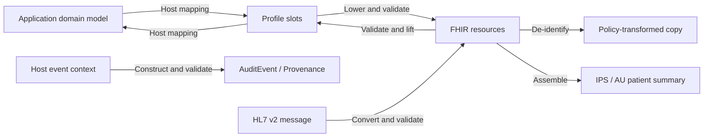

# fhir-pods

**An embeddable compliance runtime for health applications.** Let your app
**speak compliance at the edges**: lift incoming FHIR into profile-defined
inputs, lower application data into FHIR, apply de-identification policies,
assemble patient summaries, construct audit records, and convert HL7 v2
messages. Validation runs through these operations and reports what passes,
what fails, and which checks remain unresolved.

The same Rust core runs in a browser, an edge function, a server, or a mobile
app through WebAssembly, native bindings, a C ABI, or a local CLI. The host
keeps its domain model and chooses the profiles and policies for each
boundary. The runtime implements their supported data rules; the host owns
consent, access control, storage, transport, and the decision to proceed.

## The shape

FHIR is an intermediate representation for health data with constraints:
resources carry the data; profiles, terminology bindings, and FHIRPath
invariants constrain it. Those definitions can drive construction,
extraction, transformation, and verification in one runtime.



The host's mapping connects its own fields to the profile's variable slots.
Compiled definitions supply fixed codings, categories, units, and slices.
The runtime returns findings alongside its outputs so the app can decide
whether a particular import, export, or transformation is acceptable.

## Current capabilities

| Operation | What it does | What comes back |
| --- | --- | --- |
| **Lift** | Extract a resource's variable data through a compiled profile; use an explicit profile or one declared by the resource | Slot inputs, validation, missing required slots, uncovered paths (`extras`), and fixed-value `conflicts` |
| **Lower / slots** | Inspect a profile's inputs and build a resource from them, supplying the profile's fixed content | Resource and validation, including unknown inputs, type conflicts, and unmet constraints |
| **Validate** | Check base R4 structure and supported rules, declared profiles (including nested resources), extension placement, and available terminology | A typed report or FHIR `OperationOutcome`; every finding carries a stable rule id (`binding.no-code`, `inv.cmp-1`, … — [docs/rules.md](docs/rules.md)) to assert on; unsupported checks and unresolved terminology are visible; must-support gaps are available separately |
| **De-identify** | Apply a policy — the built-in `safe-harbor` rule set (modelled on HIPAA Safe Harbor's identifier list, by FHIR type; **not a compliance determination**) and/or host rules: remove or mask identifying fields, reduce date precision, pseudonymise identifiers and references with a required salt, and collapse an age over 89 where a rule names the element | Transformed resource, validation, an applied-action trail, the policy's own remaining findings, and sites a rule left in place (`residual`) |
| **Assemble documents** | Build IPS or AU Patient Summary Bundles with profile-defined sections, generated narrative, and rewritten references | Document, placed and omitted inputs, and validation |
| **Audit / provenance** | Build IHE BALP audit events for reads, queries, creates, updates, and deletes, with or without patient context; lower `Provenance` and failed-action `AuditEvent` records from base definitions | Resource and validation; the host supplies actors, time, subject, source, and correlation context |
| **HL7 v2** | Convert ER7 messages using compiled `hl7.fhir.uv.v2mappings` maps | FHIR message Bundle, validation, skipped map rows with reasons, unplaced segments, and unmapped valued fields |
| **Export** | Speak a jurisdiction: re-profile a record written against the base R4 definitions through the region's profiles (AU, US, UK, CA, NZ, or the IPS floor), assemble its patient summary, and record the read as a BALP event | Each resource through its region profile with `missing`, `extras`, and a note where none applied; the document; the audit event — every one validated |
| **Questionnaires** | Hold a `QuestionnaireResponse` to its `Questionnaire` — a contained one, a bundle entry, or one the host loaded — as the reference validator holds it: every item defined and in place, required answers, `enableWhen`, one answer unless it repeats, the answer's type and bounds (`minValue` / `maxValue`, decimal places, lengths, regex, attachment mime type and size, quantity units), `answerOption` and `answerValueSet` membership | Findings on the response item, its answer or its value, worded as the reference validator words them; a questionnaire that cannot be found is said, not guessed |
| **Terminology** | Resolve bindings through bundled sets, a host-loaded expansion table, or a synchronous provider; list unresolved requests for a host-managed lookup loop | Membership answers and outstanding terminology needs; lowering can obtain displays from the provider |
| **Host options** | Two strictness calls, both defaulting to the reference validator's own behaviour: `unknownProfile` (a declared profile this build has not compiled is a warning, or an error that fails the resource closed) and `externalNarrativeLinks` (a narrative reference out of the resource is accepted, or refused) | Taken for every call that follows, or refused whole — an options document that does not say what it means leaves the previous options in force ([docs/scope.md](docs/scope.md#host-options)) |

Lift and lower share the same slot vocabulary. Inspect `missing` and `extras`
before a round trip: values outside the covered slots are reported, not
automatically preserved. A constructed or transformed resource can still
have validation errors; inspect its report before using it.

## Use

Try the [reference health app](examples/health-app/README.md): one synthetic
check-in mapped to base FHIR, exported to any compiled region, with visible
coverage, terminology, audit and host decisions before local download.
Run `node examples/health-app/serve.mjs` after building the WASM artifact.

The WASM pod exposes the operations on one instance. The host loads the
module bytes; see the [WASM guide](pods/wasm/README.md) for build and loading
instructions.

```js
import { instantiate } from "fhir-pods-wasm";

const pod = await instantiate(wasmBytes);
const profile = "http://hl7.org.au/fhir/core/StructureDefinition/au-core-heartrate";

const slots = pod.slots(profile); // discover the variable inputs
const outgoing = pod.lower(profile, {
  status: "final",
  subject: "Patient/1",
  effectiveDateTime: "2026-09-20T08:00:00+10:00",
  "valueQuantity.value": 72,
  "valueQuantity.unit": "beats/minute",
});
// outgoing: { resource, validation }

const incoming = pod.lift(profile, outgoing.resource);
// incoming: { inputs, validation, missing, extras }
```

The same instance provides `validate`, `operationOutcome`, `mustSupportGaps`,
`deidentify`, `document`, `audit`, `export`, `v2`, `loadTerminology`, and
`terminologyNeeds`. The [Expo module](pods/expo/README.md) exports the same
operations as functions (`exportRecord` for `export`, a reserved word).

### Explicit resource terminology ownership

`loadTerminology` also accepts an atomic operational installation:

```js
const loaded = pod.loadTerminology(JSON.stringify({
  format: "fhir-pods.terminology-contexts.v1",
  contexts: [{
    terminology: originalCompiledTable,
    resources: [{ resourceType: "Observation", id: "result-one" }],
  }],
}));
if (!loaded) throw new Error("Resource terminology contexts were refused");
```

Trusted preparation explicitly assigns each owned resource to its original table.
Two resources can declare the same profile and ValueSet URLs while using distinct
complete expansions. The runtime selects by resourceType/id, including base shape,
profiles, extensions, nested resources, lower/lift, whole collections and reference
target conformance. A referenced target uses its own owner; extensions and other
subelements keep their containing resource's owner. Questionnaire semantics can use
these resource contexts too; an explicitly loaded questionnaire context continues
to own that form's semantic checks. Callers supplying both must use consistent
original tables. Exported FHIR and semantic canonical URLs remain unchanged.

Bound resources consult bundled standards and their own table only. Unknown sets
remain warnings and recorded needs, without borrowing global tables or callbacks.
Unbound resources retain the configured provider. The complete installation is
parsed before replacement; unknown/duplicate fields, invalid resource types/ids,
malformed tables and duplicate ownership keys refuse without changing state.
Binding a repeated resourceType/id inside one input (including separate contained
scopes) produces `terminology.context-ambiguous`, an error: that document needs
unique operational keys before this ownership mode can represent it. This does
not change ordinary unscoped FHIR identity rules. Conformance memoization remains
per immutable operation snapshot and target identity/profile; each target resolves
to one unique provider throughout that operation.

Installing contexts preserves the configured global table for unrelated resources.
`{ format: "fhir-pods.terminology-contexts.v1", contexts: [] }` clears ownership only.
Loading a plain table clears ownership and replaces the global table; empty input
clears both. Refused installations preserve both. Hosts must install all required
owned keys and check the boolean result; an older loader refuses this format.
The format is configuration, not a FHIR resource. Version0.25.0 retains ABI14; no
new C entrypoint or result shape. No registry/native package publication is implied.

### Exact questionnaire terminology contexts

`loadQuestionnaire` also accepts a strict operational envelope:

```js
const loaded = pod.loadQuestionnaire(JSON.stringify({
  format: "fhir-pods.questionnaire-context.v1",
  questionnaire: form, // an ordinary Questionnaire with a nonempty url/version
  terminology: compiledTable,
}));
if (!loaded) throw new Error("Questionnaire context was refused");
```

Each response must name the exact `url|version`. Its questionnaire semantics use
that form's complete table, including inside mixed/nested collections and through
lower/lift/export. Another form may use the same versionless ValueSet URL with
different members. Global tables/callbacks are not a fallback for a missing scoped
set: the result retains its unknown-membership warning and `terminologyNeeds`
records it. Bundled standard sets retain precedence. This envelope is loader
configuration, not a FHIR resource; exported resources keep their original content.
It does not scope ordinary profile bindings, which retain their configured provider.

A refused load leaves the previous entry unchanged. Plain Questionnaire loads
retain global/provider behavior; a replacement of the same canonical/version drops
its old context, and `loadQuestionnaire("")` clears all forms and contexts. ABI14
is unchanged; older builds return false for this envelope.

### Export — one transformer, every region

A global app's mapping is written **once**, against the base R4
definitions: the vital-sign profiles (`bp`, `heartrate`, `bodyweight`, …)
and the base resources compiled as lowerable profiles (`Patient`,
`Condition`, `AllergyIntolerance`, `MedicationStatement`, `Immunization`,
`Observation`, …). `export` speaks the jurisdiction:

```js
const patient = pod.lower("http://hl7.org/fhir/StructureDefinition/Patient", {
  id: "u1", identifier: [{ system: "urn:ietf:rfc:3986", value: "urn:uuid:…" }],
  name: [{ family: "Citizen", given: ["Alex"] }], gender: "female", birthDate: "1988-04-12",
}).resource;
const bp = pod.lower("http://hl7.org/fhir/StructureDefinition/bp", {
  id: "bp1", status: "final", subject: "Patient/u1", effectiveDateTime: "2026-09-20T08:00:00+10:00",
  "component:SystolicBP.valueQuantity.value": 121, "component:SystolicBP.valueQuantity.unit": "mmHg",
  "component:DiastolicBP.valueQuantity.value": 79, "component:DiastolicBP.valueQuantity.unit": "mmHg",
}).resource;

const au = pod.export("au", {
  resources: [patient, bp, /* …conditions, allergies, medications, immunizations */],
  author: "Patient/u1", date: "2026-09-21T10:00:00+10:00", title: "My health record",
  audit: { recorded: "…", client: { who: "Device/app", network: "10.0.0.7" }, server: { … }, source: { … } },
});
// au.resources[1].profile.name  → "AU Core Blood Pressure" (LOINC + SNOMED codings added by the profile)
// au.resources[0].missing       → [] — or ["identifier"] when the region wants what the record lacks
// au.document.kind              → "au-ps"; au.document.validation.valid
// au.audit.resource             → the BALP patient-read of this export
const us = pod.export("us", { …same inputs… });  // US Core profiles, IPS document
```

For each resource the region's profile is chosen by what the resource
carries (a declared `meta.profile` of the region's wins; a fixed code or
category identifies among sibling profiles; a type with one profile lineage
takes it), the resource is re-profiled through that profile's slots — the
jurisdiction's fixed content comes from the profile, the record's data from
the record, the `id` stays so references between resources survive — and
what the region requires that the record lacks is `missing`, never
invented. What no slot takes is **carried** as given where the profile's
shape allows (a note, a performer, a security label, a third component, a
local coding beside LOINC's) and verified with the rest; what cannot be
(beneath a repeating element the profile rebuilt) is `extras`, named. A
record that contradicts what the profile fixes (a pressure in kPa where
the profile fixes mm[Hg]) is not re-profiled: it goes out as given with
the contradiction in `note`. Where the region's document asks its entries
for a second profile (the IPS's Condition beside US Core's), it is
declared alongside and verified too (`also`, `alsoMissing`). A resource
nothing in the region profiles goes out as given, base-validated, with the
reason in `note`. A second `Patient`, or a top-level `subject` / `patient`
reference with a different recognizable Patient id, rejects the export.
Relative references may include `/_history/<version>`. Absolute references
with a matching id, opaque or logical references, and records without a
Patient id receive an unresolved-identity `notes` entry for the host to
resolve; this check does not establish identity across servers or nested
resources. Regions: `au` (AU Core + AU Patient Summary), `us` (US Core + IPS
document), `uk` (UK Core STU2 + IPS document), `ca` (CA Baseline + IPS
document), `nz` (NZ Base + IPS document), `ips` (the international floor —
what to use for a jurisdiction without a compiled guide; `profiles()` lists
them). Offline, an IPS
document with any Observation needs the IG's two pregnancy LOINC sets
loaded (`loadTerminology`, code-only) to tell its pregnancy entries apart —
the same limit the reference validator has without a terminology server.

Discovery goes with it: `profiles()` lists the regions and every compiled
profile (url, name, resource type, kind, base); `slots(url)` shows, per
slot, what the profile fixes beside it (`fixed` — the UCUM code next to a
Quantity's `unit`, which lowering writes as the unit when none is given)
and the members of a composite datatype slot (`parts` — a `HumanName`'s
`family`, `given`…), so a host fills either without the specification.

In Rust, the shared operation context is currently named `Validator`:

```rust
use fhir_pods_core::Validator;

let runtime = Validator::new(); // reuse the parsed invariant expressions
let profile = "http://hl7.org.au/fhir/core/StructureDefinition/au-core-heartrate";
let outgoing = runtime.lower(profile, br#"{
    "status": "final", "subject": "Patient/1",
    "effectiveDateTime": "2026-09-20T08:00:00+10:00",
    "valueQuantity.value": 72, "valueQuantity.unit": "beats/minute"
}"#)?;
let incoming = runtime.lift(profile, outgoing.resource.as_bytes())?;
// Inspect outgoing.validation and incoming.{validation, missing, extras}.
```

Validation findings are data. An operation that cannot start returns a Rust
`Result::Err`, a C ABI JSON error, or a thrown error in the JS wrappers.

For scripts and local workflows, the [CLI](crates/fhir-pods-cli/README.md)
offers the same operation family:

```sh
cargo install --path crates/fhir-pods-cli
fhir-pods slots http://hl7.org.au/fhir/core/StructureDefinition/au-core-heartrate
fhir-pods lower http://hl7.org.au/fhir/core/StructureDefinition/au-core-heartrate inputs.json
fhir-pods lift "" observation.json
fhir-pods document ips summary-inputs.json
fhir-pods audit patient-read event.json
fhir-pods v2 message.hl7 --timezone +10:00
```

## Compiled coverage

The current registry contains **1,154 profile definitions**, including **833
extension definitions**, generated from pinned packages: **AU Core 2.0.0**,
**US Core 6.1.0**, **IPA 1.1.0**, **IPS 2.0.1**, **AU Patient Summary 1.0.0**,
**IHE BALP 1.1.4**, **AU Base 6.0.0**, **HL7 extensions for R4 5.3.0**,
**UK Core STU2 2.1.0**, **CA Baseline 1.2.0**, **NZ Base 3.1.0**,
plus the base R4 vital-sign profiles and the base `AuditEvent`, `Provenance`,
`Patient`, `Observation`, `Condition`, `AllergyIntolerance`,
`MedicationStatement`, `MedicationRequest`, `Medication`, `Immunization`,
`Procedure`, `Device`, `DeviceUseStatement`, `Practitioner`, `Organization`,
`Questionnaire` and `QuestionnaireResponse` definitions as lowerable profiles
(the region-neutral vocabulary `export` re-profiles from; a form and its
answers, the answers held to the form on the way out).
The type table covers every R4 resource and datatype.

Terminology includes **146 value sets** and code membership tables for
**1,212 complete code systems** from R4 core and HL7 terminology (THO 7.3.0).
SNOMED CT and LOINC terminology content, and externally hosted sets, come
through the host's terminology provider or expansion tables. Fixed profile
codings can carry system and code references without bundled licensed
displays. See [scope](docs/scope.md) for the supported checks and limits.

The registry is compiled into the artifact. Supporting another implementation
guide means adding its packages to the generator and proving the resulting
behavior. The host selects the applicable profiles and policies; the runtime
does not infer a jurisdiction or supply a complete regional compliance regime.

## Delivery and implementation

| Surface | Delivery |
| --- | --- |
| **WebAssembly** | Dependency-free JS wrapper for browser, edge, Node, Bun, and Deno; v0.23.0 artifact is 3,110,336 bytes (809,141 bytes gzip-9). [Guide](pods/wasm/README.md) |
| **Expo** | Native iOS XCFramework and Android jniLibs behind the Expo Modules API. [Guide](pods/expo/README.md) |
| **Rust / C** | `fhir_pods_core` directly or the shared [ABI 14 header](crates/fhir-pods-ffi/include/fhir_pods.h) |
| **CLI** | Local JSON/ER7 input, structured output, and exit codes for scripting. [Guide](crates/fhir-pods-cli/README.md) |

The Rust core is `no_std` with `alloc`, zero dependencies, and no `unsafe`.
Generators compile package definitions into static constraint tables,
construction skeletons, slots, type information, and conversion maps. The
runtime applies those tables to each input; it performs no network or
storage I/O. The host provides time, salts, external terminology, and event
context as needed.

[Architecture](docs/architecture.md) explains the shared engine and bindings.
[Native benchmarks](bench/README.md) measure validation, lowering,
de-identification, and document assembly; [WASM benchmarks](pods/wasm/bench/README.md)
measure calls through the JS wrapper. Measurements are tied to their recorded
versions and fixtures.

## Evidence and limits

The release gate checks the validation verdicts of published examples,
targeted probes, and outputs from lift/lower, de-identification, document
assembly, audit construction, HL7 v2 conversion and export (one base record
spoken for every region: 39 resources, documents and audit events) against
**HL7 Java validator 6.10.4**, with remote terminology disabled. Operation-specific
tests also check extracted values, transformations, content, and reporting.
Verdict agreement alone does not establish semantic correctness or complete
compliance.

| Lane | Measured (ABI 14; each row names its release) |
| --- | --- |
| Release corpus | **1,818/1,818** verdicts agree at 0.27.0 (UK Core, CA Baseline and NZ Base examples, six regions' export outputs, the base's binding fixtures, the probes; `conformance/run.py`); `conformance/reasons.py` puts every error-level issue side by side — three triaged residues on 1,818 files, 0 untriaged |
| Probes | **65/65** agree three ways at 0.27.0 (expectation, oracle, pod) — synthetic fixtures for JSON shapes, primitive limits, extensions, contained resources, unknown profiles, offline references, required coded content, a de-identified age over 89, the base's `SimpleQuantity` and an IG's own datatype profiles (`NzAddress`, `NzContactpoint`, CA's `profile-identifier`, `au-address`, the AU identifier profiles), each against the oracle loaded with its own guide (`conformance/probes/run.py`) |
| Narrative | **42/42** agree three ways at 0.22.0 — synthetic `Narrative.div` cases: text ending mid-markup, quoted `>` and unterminated attribute values, what an image's source is checked for (`conformance/narrative/run.py`) |
| Published R4 examples | **5,155/5,287** compared verdicts agree at 0.27.0 (re-judged against the cached oracle); **132** lenient differences, every one reviewed; **0** stricter; out of 5,292 selected inputs, **2** explicit oracle exclusions and **3** order-dependent oracle cases (`StructureDefinition-Parameters`, `-Task`, `-TestReport` — the oracle's own iteration order decides which definition it names), and the allergy extension's order-dependent message accepted only as the mechanism allows; none counted as agreement (`conformance/base.py`) |
| Published validator base tests | **84** of 492 R4 JSON cases compare at 0.22.0 (408 excluded: terminology service, fetchers, packages, policies, separate lanes): **64/84** agree with stored Java outcomes, **14/20** with stored Firely outcomes; 18 lenient, 2 stricter than the stored Java outcome, 0 stricter than both stored engines — every difference reviewed (`conformance/testcases.py`) |
| Questionnaire tests | **81 of 96** R4 JSON cases compare at 0.22.0 (the rest name an SDC package, a launch context, a validator policy option or a supporting ValueSet): **74/81** verdicts agree and **73/81** agree on every error-level issue; 7 lenient, 0 stricter on the verdict. The lane exits 1 on `nested-questionnaire-nested-valueset` (invalid on both sides): validator_cli 6.10.4 reports its nine answer codings without a system as warnings ("A code with no system has no defined meaning…"), the pod — since 0.19.4 — as nine errors, so on those findings the pod is stricter than the oracle, a pod defect; the lane fails until the pod is fixed (`conformance/questionnaire.py`) |
| Supporting-resource tests | **11 of 160** cases compare at 0.22.0 (the rest are the questionnaire lane's, or need a package, an IG, a validator option, a filter): **9/11** agree on the verdict and on every error-level issue; 2 lenient, 0 stricter (`conformance/supporting.py`) |
| HL7 v2 sample messages | **77 of 139** public synthetic messages convert at 0.22.0 (62 name structures the maps do not cover); every bundle before validator_cli: **77/77** verdicts agree, **74/77** on every error, 0 stricter — and all 77 are invalid on both sides, for reasons the lane lists (`conformance/v2samples.py`) |
| Mutation lane | **19,067/19,067** derived files agree on the verdict at 0.22.0 (0 untriaged again at 0.27.0, `--reuse-oracle`) — every release-corpus original under nine fixed mutations (drop, code-less and text-only concept, wrong JSON type, empty backbone, bad enum, null primitive, empty string, bad and bare reference, orphan extension); 0 lenient, 0 stricter, 0 untriaged. On 2,291 of them, invalid on both sides, the oracle reports an error path the pod does not — reported, not gated (`conformance/mutate.py`) |
| Instrument-path scenario | **71/71** verdicts agree at 0.22.0 — one synthetic end-to-end scenario: a sixteen-part questionnaire instrument with its own code systems and value sets (placeholder content, no real instrument), responses held to it, the derived resources (observations, a flag, a summary `Composition`, a referral, a consent, an export bundle, an audit event), each lifted and lowered, de-identified and exported for the AU region; judged three ways with the definitions loaded into the oracle as an IG folder; 70 agree on every error path, one triaged residue (`conformance/instrument.py --chain`). `--host-profile` compiles the scenario's own score profile into a feature build and judges **7/7** more against the oracle given the same definition |
| Synthea cohort | **14/14** bundles (10 seeded patients + hospital + practitioner, 27.3 MB, 9,482 US Core entries) agree at 0.22.0 on the verdict and on every error-level issue; the pod validates the whole cohort in 4.39 s (6.2 MB/s; largest bundle 9.7 MB in 1.65 s), measured on a loaded machine. The oracle side is one JVM over the 14 bundles; larger cohorts are not measured (`conformance/synthea.py`) |
| Ad-hoc profile tests | **13 of 53** cases compare at 0.22.0: **12/13** agree with Java and **7/7** with Firely where available; 1 reviewed lenient, 0 stricter; 40 have compiler (28), snapshot, package, policy, SMART Health Card or cross-version exclusions (`conformance/testcases.py --profiles`) |

The broader lanes enforce reviewed baselines: new or changed differences and
unusable evidence fail. Exclusions are never counted as agreement; "compare"
counts the cases put before both sides, "agree" those where they match. At
0.22.0 the workspace runs **277 Rust tests**, **22 wasm Node tests** and **25
Python harness checks**, clippy clean; the [changelog](CHANGELOG.md) separates
released artifacts from unreleased corrections. [Conformance commands](conformance/README.md) and
[detailed scope](docs/scope.md) describe reproduction and the remaining gaps.

`valid` means no error or fatal finding among the checks that ran. Unknown
profiles, unsupported expressions, and unresolved terminology can still
produce warnings. The app must inspect those findings along with each
operation's coverage fields when deciding whether its requirements are met.

## Development

- `crates/fhir-pods-core` — lift/lower, verification, de-identification,
  document assembly, audit, v2 conversion, terminology, and compiled data.
- `crates/fhir-pods-ffi`, `pods/wasm`, `pods/expo` — shared ABI and bindings.
- `crates/fhir-pods-cli` — the local command-line surface.
- `tools/`, `scripts/` — definition generators, build and release tooling.
- `conformance/` — differential lanes, reviewed differences, and probes.
- `docs/` — [architecture](docs/architecture.md), [domain model](docs/domain-model.md),
  [scope](docs/scope.md), [roadmap](docs/roadmap.md), and [history](docs/history.md).

```sh
cargo test --workspace                       # unit, integration, and bounded seeded fuzz checks
./scripts/check-no-std.sh                    # bare-metal core build
JAVA_HOME=<jdk17> python3 conformance/run.py # release conformance gate
python3 conformance/base.py                 # published R4 regression gate
target/debug/fhir-pods gate --questionnaire q.json [--options o.json] FILE…   # CI / acceptance gate: verdict and findings by rule id, exit 1 on any error
JAVA_HOME=<jdk17> python3 conformance/narrative/run.py   # the narrative probes, against the oracle
JAVA_HOME=<jdk17> python3 conformance/coded-answers/run.py   # coded answers with a part missing, against the oracle
JAVA_HOME=<jdk17> python3 conformance/mutate.py   # mutation lane: every original under nine mutations
JAVA_HOME=<jdk17> python3 conformance/instrument.py --chain   # instrument-path scenario, end to end
./scripts/gen-profiles.sh                   # regenerate the registry from pinned packages
./scripts/smoke-c.sh                        # exercise the C ABI from C
./scripts/build-wasm.sh                     # build the WASM artifact
(cd pods/wasm && npm test)                   # exercise the JS wrapper
./scripts/release.sh                        # package artifacts with SHA256SUMS
```

### Host profiles

A host's own profiles — a score `Observation`, a programme's
`QuestionnaireResponse` constraints — are compiled into the pod at build
time, the same way the shipped registry is, and selected by declaration
(`meta.profile`) like any shipped profile:

```bash
./scripts/gen-host-profiles.sh path/to/your/package     # StructureDefinitions with snapshots, as JSON
cargo build --features host-profiles                    # core / cli
FEATURES=host-profiles ./scripts/build-wasm.sh          # the pods (ios / android likewise)
./scripts/gen-host-profiles.sh --reset                  # back to the stub
```

`profiles()` includes optional `sourceSha256` for compiled host profiles: SHA256
of the exact original StructureDefinition file bytes consumed by the compiler.
The build stages a private copy of host inputs and compiles and fingerprints that
same copy, so changes to the original package cannot substitute a different source
after compilation. Duplicate input canonicals refuse before registry replacement.
The fingerprint is compiled into the artifact, not supplied by the caller at run
time. Verify the artifact itself, then compare this field with the corresponding
verified package file digest before relying on its declared profile. A missing or
mismatched fingerprint is not evidence of matching source. URL/type/version alone
are insufficient. Compile from the package's original files: formatting changes
also change this byte identity; nothing silently canonicalizes or rewrites them.
Shipped profiles/older artifacts do not claim host source identities; `--reset`
clears host fingerprint metadata along with the host registry for the next build.
This metadata identifies input bytes, not independent-engine or clinical acceptance.
Version0.26.0 retains ABI14 and adds no entrypoint or changed validation rule.

The host package is primary: every resource profile, `Identifier` and
complex `Extension` profile in it is compiled, and so is any other datatype
profile of its own that an element is held to alone (a host `Address`
profile, as NZ Base's `NzAddress`); the pinned packages are what
it may derive from and slice by (AU Core, US Core, IPS, …). The registry is
written only when the whole package compiles: a profile the shipped registry
already holds is refused (the shipped one comes first in the registry, so it
could never shadow it anyway), and a definition without a snapshot is refused
by name — a differential alone compiles to nothing. The profiles' own
invariant keys get stable rule ids (`inv.<key>`) in the host build, as the
shipped ones do. Host value sets and code systems are not bundled: give them
to the pod as a terminology table (`tools/compile_valueset.py`) or a
terminology provider.
The instrument-path lane proves the whole path (`conformance/instrument.py
--host-profile`): a synthetic score profile compiled into a feature build
and judged against validator_cli with the same definition.

## License

MIT © 2026 Justin Grosvenor. See [LICENSE](LICENSE).
