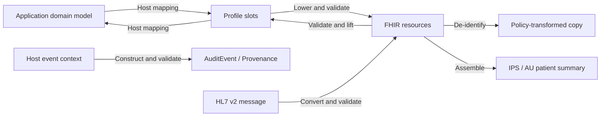

# fhir-pods

**An embeddable compliance runtime for health applications.** Let your app
**speak compliance at the edges**: lift incoming FHIR into profile-defined
inputs, lower application data into FHIR, apply de-identification policies,
assemble patient summaries, construct audit records, and convert HL7 v2
messages. Validation runs through these operations and reports what passes,
what fails, and which checks remain unresolved.

The same Rust core runs in a browser, an edge function, a server, or a mobile
app through WebAssembly, native bindings, a C ABI, or a local CLI. The host
keeps its domain model and chooses the profiles and policies for each
boundary. The runtime implements their supported data rules; the host owns
consent, access control, storage, transport, and the decision to proceed.

## The shape

FHIR is an intermediate representation for health data with constraints:
resources carry the data; profiles, terminology bindings, and FHIRPath
invariants constrain it. Those definitions can drive construction,
extraction, transformation, and verification in one runtime.



The host's mapping connects its own fields to the profile's variable slots.
Compiled definitions supply fixed codings, categories, units, and slices.
The runtime returns findings alongside its outputs so the app can decide
whether a particular import, export, or transformation is acceptable.

## Current capabilities

| Operation | What it does | What comes back |
| --- | --- | --- |
| **Lift** | Extract a resource's variable data through a compiled profile; use an explicit profile or one declared by the resource | Slot inputs, validation, missing required slots, and paths not covered by the extraction (`extras`) |
| **Lower / slots** | Inspect a profile's inputs and build a resource from them, supplying the profile's fixed content | Resource and validation, including unknown inputs, type conflicts, and unmet constraints |
| **Validate** | Check base R4 structure and supported rules, declared profiles (including nested resources), extension placement, and available terminology | A typed report or FHIR `OperationOutcome`; unsupported checks and unresolved terminology are visible; must-support gaps are available separately |
| **De-identify** | Apply the built-in `safe-harbor` policy or host rules: remove or mask identifying fields, reduce date precision, and pseudonymise identifiers and references with a host-supplied salt | Transformed resource, validation, an applied-action trail, remaining checker findings, and free-text sites retained by host rules (`residual`) |
| **Assemble documents** | Build IPS or AU Patient Summary Bundles with profile-defined sections, generated narrative, and rewritten references | Document, placed and omitted inputs, and validation |
| **Audit / provenance** | Build IHE BALP audit events for reads, queries, creates, updates, and deletes, with or without patient context; lower `Provenance` and failed-action `AuditEvent` records from base definitions | Resource and validation; the host supplies actors, time, subject, source, and correlation context |
| **HL7 v2** | Convert ER7 messages using compiled `hl7.fhir.uv.v2mappings` maps | FHIR message Bundle, validation, skipped map rows with reasons, unplaced segments, and unmapped valued fields |
| **Terminology** | Resolve bindings through bundled sets, a host-loaded expansion table, or a synchronous provider; list unresolved requests for a host-managed lookup loop | Membership answers and outstanding terminology needs; lowering can obtain displays from the provider |

Lift and lower share the same slot vocabulary. Inspect `missing` and `extras`
before a round trip: values outside the covered slots are reported, not
automatically preserved. A constructed or transformed resource can still
have validation errors; inspect its report before using it.

## Use

The WASM pod exposes the operations on one instance. The host loads the
module bytes; see the [WASM guide](pods/wasm/README.md) for build and loading
instructions.

```js
import { instantiate } from "fhir-pods-wasm";

const pod = await instantiate(wasmBytes);
const profile = "http://hl7.org.au/fhir/core/StructureDefinition/au-core-heartrate";

const slots = pod.slots(profile); // discover the variable inputs
const outgoing = pod.lower(profile, {
  status: "final",
  subject: "Patient/1",
  effectiveDateTime: "2026-09-20T08:00:00+10:00",
  "valueQuantity.value": 72,
  "valueQuantity.unit": "beats/minute",
});
// outgoing: { resource, validation }

const incoming = pod.lift(profile, outgoing.resource);
// incoming: { inputs, validation, missing, extras }
```

The same instance provides `validate`, `operationOutcome`, `mustSupportGaps`,
`deidentify`, `document`, `audit`, `v2`, `loadTerminology`, and
`terminologyNeeds`. The [Expo module](pods/expo/README.md) exports the same
operations as functions.

In Rust, the shared operation context is currently named `Validator`:

```rust
use fhir_pods_core::Validator;

let runtime = Validator::new(); // reuse the parsed invariant expressions
let profile = "http://hl7.org.au/fhir/core/StructureDefinition/au-core-heartrate";
let outgoing = runtime.lower(profile, br#"{
    "status": "final", "subject": "Patient/1",
    "effectiveDateTime": "2026-09-20T08:00:00+10:00",
    "valueQuantity.value": 72, "valueQuantity.unit": "beats/minute"
}"#)?;
let incoming = runtime.lift(profile, outgoing.resource.as_bytes())?;
// Inspect outgoing.validation and incoming.{validation, missing, extras}.
```

Validation findings are data. An operation that cannot start returns a Rust
`Result::Err`, a C ABI JSON error, or a thrown error in the JS wrappers.

For scripts and local workflows, the [CLI](crates/fhir-pods-cli/README.md)
offers the same operation family:

```sh
cargo install --path crates/fhir-pods-cli
fhir-pods slots http://hl7.org.au/fhir/core/StructureDefinition/au-core-heartrate
fhir-pods lower http://hl7.org.au/fhir/core/StructureDefinition/au-core-heartrate inputs.json
fhir-pods lift "" observation.json
fhir-pods document ips summary-inputs.json
fhir-pods audit patient-read event.json
fhir-pods v2 message.hl7 --timezone +10:00
```

## Compiled coverage

The current registry contains **979 profile definitions**, including **749
extension definitions**, generated from pinned packages: **AU Core 2.0.0**,
**US Core 6.1.0**, **IPA 1.1.0**, **IPS 2.0.1**, **AU Patient Summary 1.0.0**,
**IHE BALP 1.1.4**, **AU Base 6.0.0**, and **HL7 extensions for R4 5.3.0**,
plus base R4 vital-sign profiles and the `AuditEvent` and `Provenance` definitions.
The type table covers every R4 resource and datatype.

Terminology includes **126 value sets** and code membership tables for
**1,212 complete code systems** from R4 core and HL7 terminology (THO 7.3.0).
SNOMED CT and LOINC terminology content, and externally hosted sets, come
through the host's terminology provider or expansion tables. Fixed profile
codings can carry system and code references without bundled licensed
displays. See [scope](docs/scope.md) for the supported checks and limits.

The registry is compiled into the artifact. Supporting another implementation
guide means adding its packages to the generator and proving the resulting
behavior. The host selects the applicable profiles and policies; the runtime
does not infer a jurisdiction or supply a complete regional compliance regime.

## Delivery and implementation

| Surface | Delivery |
| --- | --- |
| **WebAssembly** | Dependency-free JS wrapper for browser, edge, Node, Bun, and Deno; v0.10.0 artifact is 2,387,366 bytes (586,075 bytes gzip-9). [Guide](pods/wasm/README.md) |
| **Expo** | Native iOS XCFramework and Android jniLibs behind the Expo Modules API. [Guide](pods/expo/README.md) |
| **Rust / C** | `fhir_pods_core` directly or the shared [ABI 10 header](crates/fhir-pods-ffi/include/fhir_pods.h) |
| **CLI** | Local JSON/ER7 input, structured output, and exit codes for scripting. [Guide](crates/fhir-pods-cli/README.md) |

The Rust core is `no_std` with `alloc`, zero dependencies, and no `unsafe`.
Generators compile package definitions into static constraint tables,
construction skeletons, slots, type information, and conversion maps. The
runtime applies those tables to each input; it performs no network or
storage I/O. The host provides time, salts, external terminology, and event
context as needed.

[Architecture](docs/architecture.md) explains the shared engine and bindings.
[Native benchmarks](bench/README.md) measure validation, lowering,
de-identification, and document assembly; [WASM benchmarks](pods/wasm/bench/README.md)
measure calls through the JS wrapper. Measurements are tied to their recorded
versions and fixtures.

## Evidence and limits

The release gate checks the validation verdicts of published examples,
targeted probes, and outputs from lift/lower, de-identification, document
assembly, audit construction, and HL7 v2 conversion against **HL7 Java
validator 6.10.4**, with remote terminology disabled. Operation-specific
tests also check extracted values, transformations, content, and reporting.
Verdict agreement alone does not establish semantic correctness or complete
compliance.

| Lane | Latest recorded result |
| --- | --- |
| Release corpus | **1,521/1,521** verdicts agree at v0.10.0 and the subsequent core fixes |
| Published R4 examples | **4,811/5,290** compared verdicts agree; **479** reviewed lenient differences; **2** explicit oracle exclusions out of 5,292 selected inputs; no stricter verdicts |
| Published validator base tests | **57/84** agree with stored Java outcomes; **14/20** with stored Firely outcomes; differences are reviewed individually |
| Ad-hoc profile tests | **10 of 53** cases compare: **9/10** agree with Java and **7/7** with Firely where available; other cases have compiler, snapshot, or manifest exclusions |

The broader lanes enforce reviewed baselines: new or changed differences and
unusable evidence fail. Exclusions are never counted as agreement. The latest
core follow-up records **211 Rust workspace tests** and **18 Python harness
checks**; the [changelog](CHANGELOG.md) separates released artifacts from
unreleased corrections. [Conformance commands](conformance/README.md) and
[detailed scope](docs/scope.md) describe reproduction and the remaining gaps.

`valid` means no error or fatal finding among the checks that ran. Unknown
profiles, unsupported expressions, and unresolved terminology can still
produce warnings. The app must inspect those findings along with each
operation's coverage fields when deciding whether its requirements are met.

## Development

- `crates/fhir-pods-core` — lift/lower, verification, de-identification,
  document assembly, audit, v2 conversion, terminology, and compiled data.
- `crates/fhir-pods-ffi`, `pods/wasm`, `pods/expo` — shared ABI and bindings.
- `crates/fhir-pods-cli` — the local command-line surface.
- `tools/`, `scripts/` — definition generators, build and release tooling.
- `conformance/` — differential lanes, reviewed differences, and probes.
- `docs/` — [architecture](docs/architecture.md), [domain model](docs/domain-model.md),
  [scope](docs/scope.md), [roadmap](docs/roadmap.md), and [history](docs/history.md).

```sh
cargo test --workspace                       # unit, integration, and bounded seeded fuzz checks
./scripts/check-no-std.sh                    # bare-metal core build
JAVA_HOME=<jdk17> python3 conformance/run.py # release conformance gate
python3 conformance/base.py                 # published R4 regression gate
./scripts/gen-profiles.sh                   # regenerate the registry from pinned packages
./scripts/smoke-c.sh                        # exercise the C ABI from C
./scripts/build-wasm.sh                     # build the WASM artifact
(cd pods/wasm && npm test)                   # exercise the JS wrapper
./scripts/release.sh                        # package artifacts with SHA256SUMS
```

## License

MIT © 2026 Justin Grosvenor. See [LICENSE](LICENSE).
